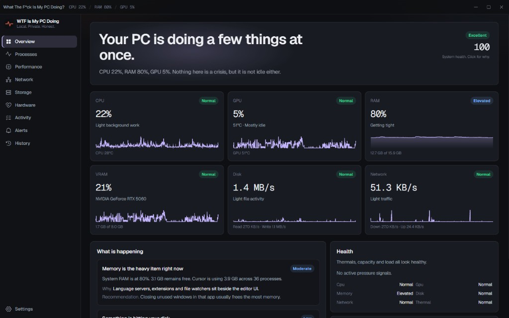
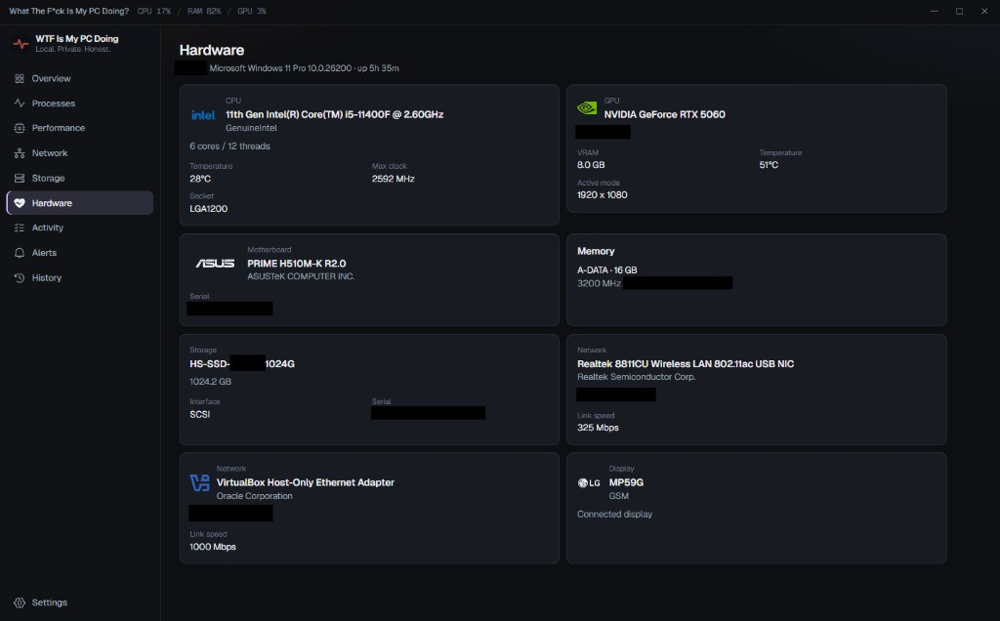

<p align="center">
  
</p>

<h1 align="center">What The F\*ck Is My PC Doing?</h1>

<p align="center">
  Local. Private. Honest.<br />
  Windows Task Manager tells you Chrome is at 12%.<br />
  This tells you why the machine feels like that.
</p>

<p align="center">
  
</p>

<p align="center">
  
</p>

## Inside

 **Headlines, not a spreadsheet.** "Your PC is chilling" vs "RAM is getting crowded."

 **Click CPU, RAM, GPU, or VRAM.** See what is actually using it, Chrome grouped.

 **Hardware with real vendor marks.** Live VRAM, disk queue, active time. Not a WMI dump in a list view.

 **Alerts that wait.** A 2-second spike does not scream.

 **Stays on the machine.** SQLite in app data. No account. Discord presence is off until you turn it on.

## Run

```bash
npm install
npm run tauri dev
```

Windows. Rust toolchain required for the Tauri side.

**Tauri 2 + React 19 + TypeScript + Vite + Tailwind v4 + Rust.** Telemetry, analysis, tray, and Discord IPC live in Rust.

## License

MIT
